# Nature's Note

**A full stack ecommerce website for a real men's fragrance brand. I designed, built and run it.**

Live at [naturesnotefragrances.com](https://naturesnotefragrances.com)

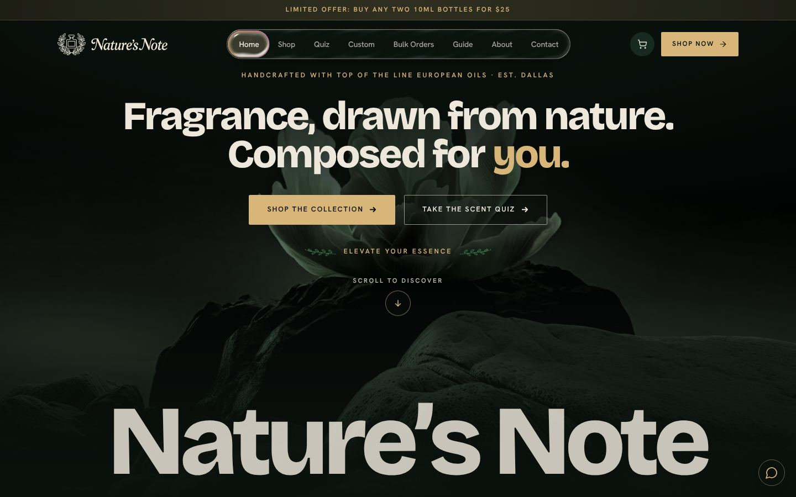

## The website

Nature's Note sells hand blended extrait de parfum made with European oils. The site is a storefront, a checkout and an internal studio for the content team, built as one React and Supabase application.

| | |
|---|---|
| 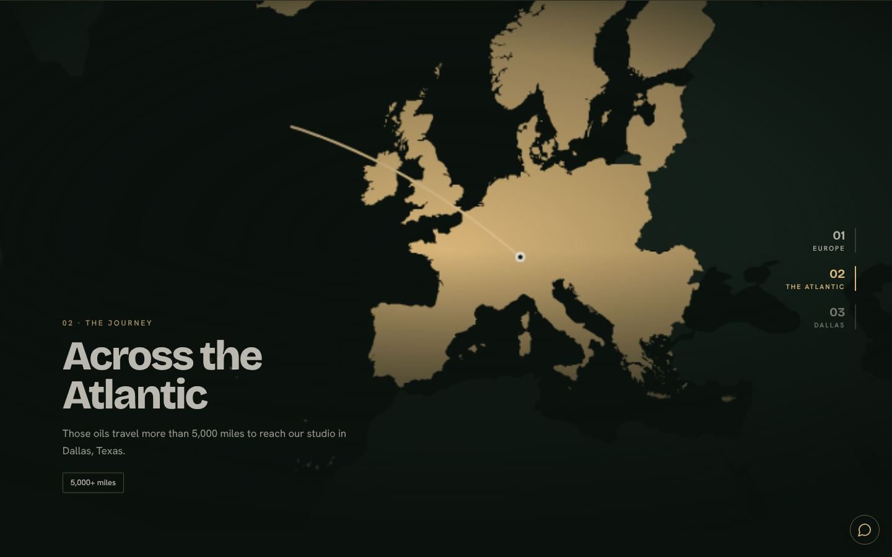 | 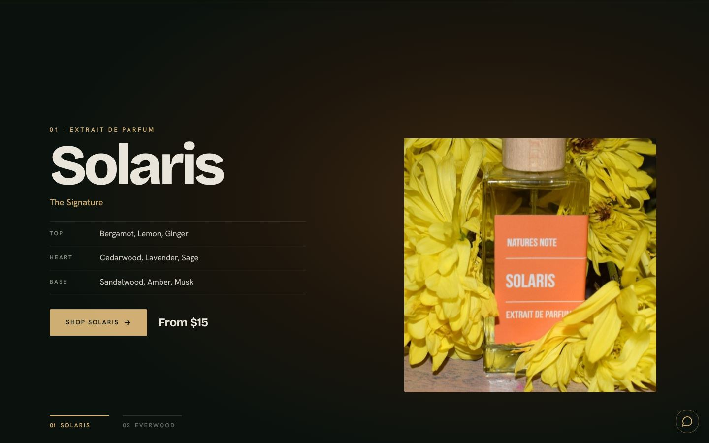 |
| **Scroll driven story.** A pinned map follows the oils from Europe to the studio in Dallas. | **Pinned product stages.** Each scent gets a full screen stage with notes and pricing. |
| 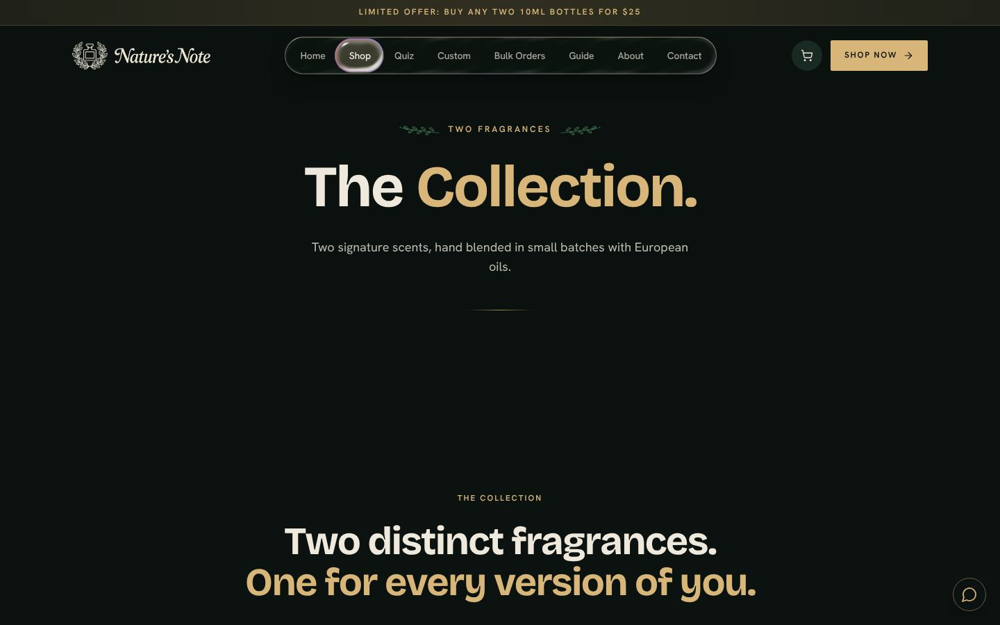 | 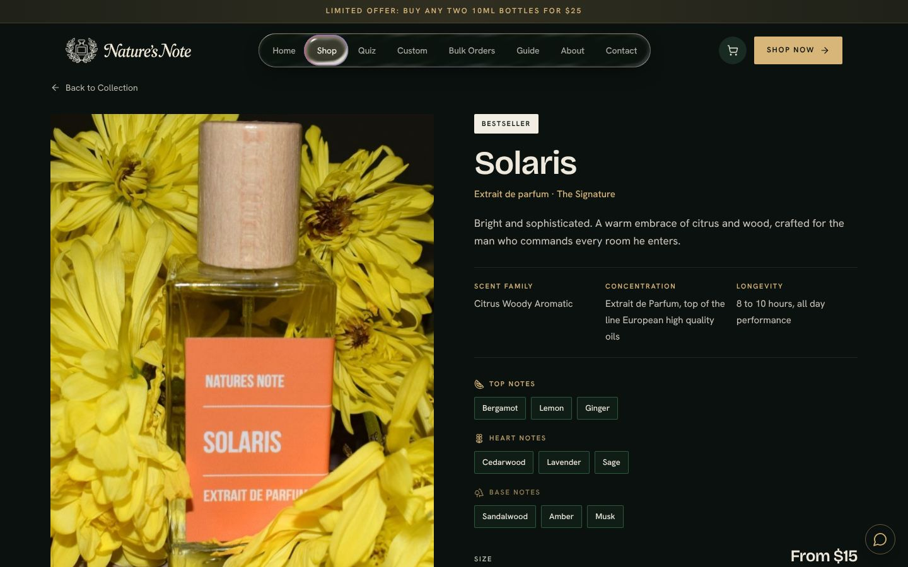 |
| **Shop.** The full collection with sizes and prices. | **Product pages.** Top, heart and base notes, sizes and add to cart. |
| 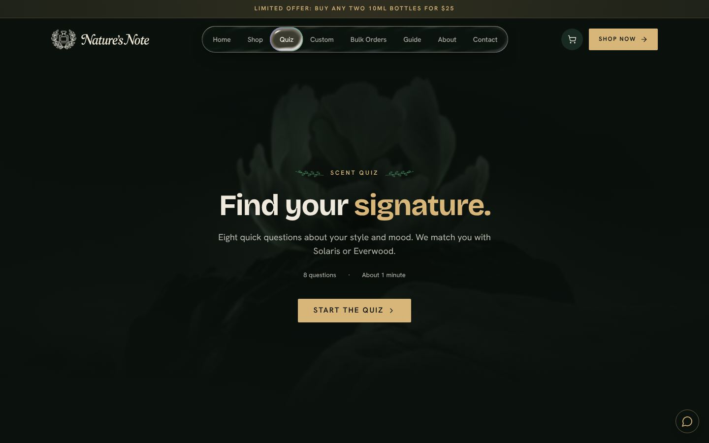 | 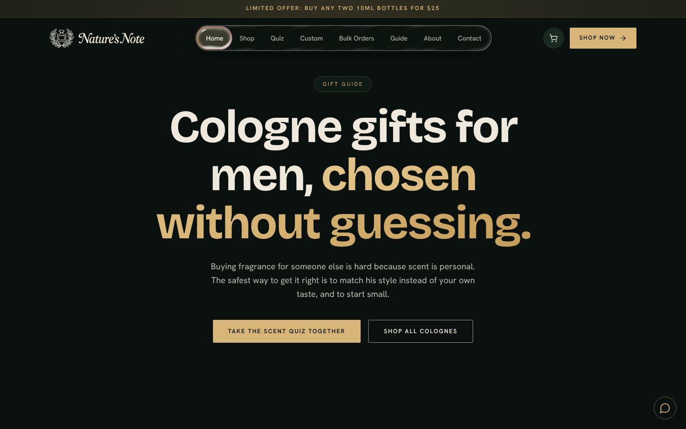 |
| **Scent quiz.** Recommends a fragrance from lifestyle and mood. | **Guides.** Search friendly articles on choosing and wearing cologne. |

On a phone:

  
  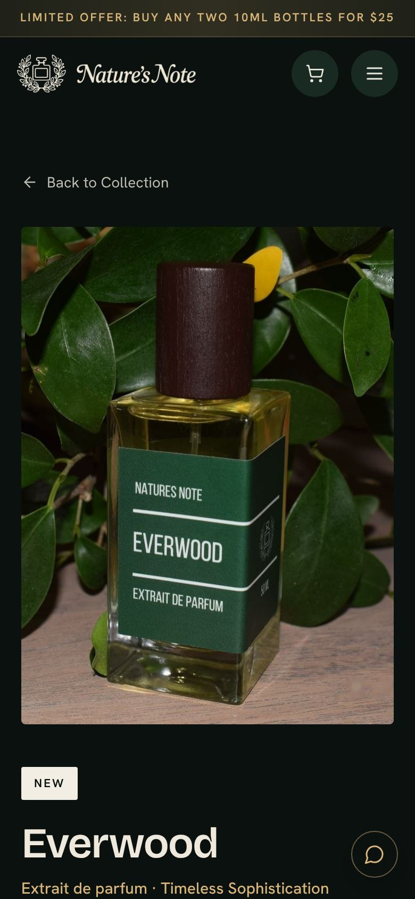

### What customers can do

- Browse the collection, read the notes and sizes, and add bottles to the cart
- Check out with card, Apple Pay or Google Pay through Stripe
- Take the scent quiz to find a match
- Request a custom scent or a bulk order, with an address map picker
- Ask the chat assistant questions
- Read guides on choosing, wearing and gifting cologne

### What the business gets

- An owner portal for reviewing content, a calendar, a library and a roster
- An intern studio where each team member signs in separately, plans and drafts posts, uploads work and gets feedback, and sees only their own files
- Weekly exports of submitted work, organized by person and week
- A transactional email queue with suppression and unsubscribe handling, and exactly one owner email per paid order

## Engineering achievements

**Payments and orders**
- Stripe checkout with an embedded Apple Pay and Google Pay button, verified end to end
- Paid orders notify the owner once, whichever of the Stripe webhook or the payment verifier sees the order first
- Email side effects use idempotency keys with checked retries, so alerts never duplicate

**Security**
- Three separate sign in systems for customers, owners and interns
- Intern credentials are hashed, generated on the server and never stored in plaintext, and sessions are opaque and expire
- Row level security on every table, with direct public writes denied
- Triggers serialize versioned uploads so concurrent submissions cannot lose history
- A shared atomic rate limiter on guest forms, keyed on a hashed email, so switching forms cannot get around the limit
- Content Security Policy, a `security.txt` file and a strict referrer policy

**Quality**
- 53 automated tests on the shared server code
- One set of validation rules runs on the client and the server, and a test checks that the content catalog matches the product data
- Deadlines and weekly metrics use shared, tested helpers that stay correct across daylight saving changes
- A layout audit across 15 pages at desktop and phone sizes with no overflow or overlap

**Performance and accessibility**
- Self hosted fonts, preloaded, with no third party font requests
- Route level code splitting, so the landing page ships without the rest of the app
- Scroll animation runs on transform and opacity only and respects the reduced motion setting, with a static fallback for each animated section

**Search**
- Every route sets its own title, description, canonical URL and social preview tags, and the build writes a static HTML file per route so link previews and crawlers see the right page
- Product, organization, local business and article structured data, a sitemap with dates, and 8 original cologne guides
- Crawlable shop text on the first load, so web filters and non JavaScript crawlers can read the site

**Design**
- Custom type system (Bricolage Grotesque and Hanken Grotesk), a single dark theme with a champagne accent, and a liquid glass navigation menu rendered with WebGL, with a CSS fallback

## Tech stack

| Layer | Tools |
|---|---|
| Frontend | React, TypeScript, Vite, Tailwind CSS, shadcn/ui, Radix |
| Motion and graphics | Framer Motion, WebGL, d3 geo for the map |
| Data and forms | TanStack Query, React Hook Form, Zod |
| Backend | Supabase (PostgreSQL, Auth, Storage, Edge Functions in Deno) |
| Payments | Stripe, Apple Pay, Google Pay |
| Maps | Leaflet |
| Testing | Bun test, Playwright audits |

## Architecture

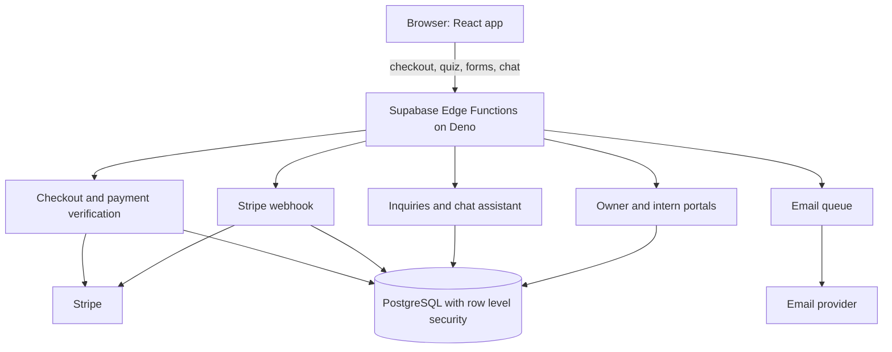

## Order flow

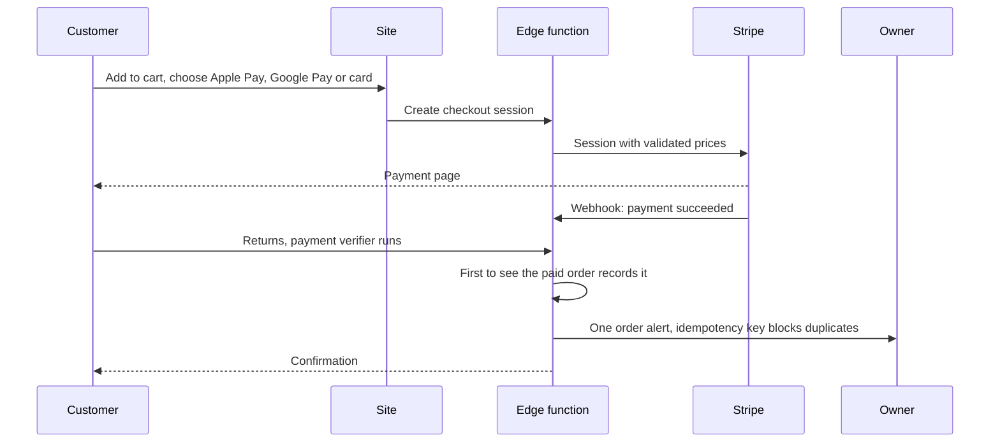

## Access model

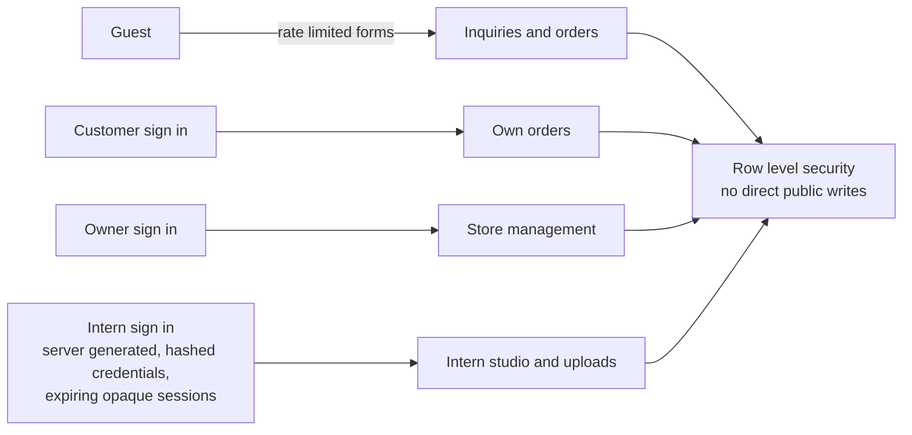

## Search pipeline

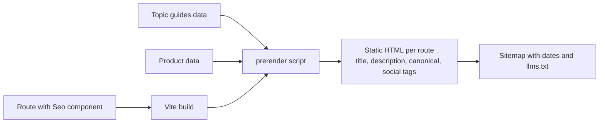

The application source is kept private because it includes the live store and its staff tools. This repo is the public write up of the site.
